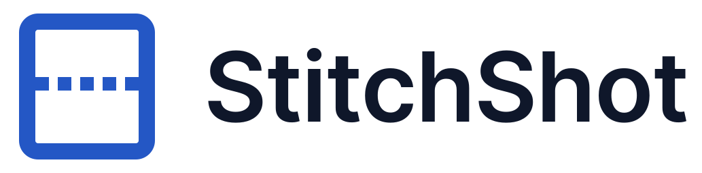

<p align="center">
  <picture>
    <source media="(prefers-color-scheme: dark)" srcset="design/logo/dist/stitchshot-horizontal-on-dark.svg">
    
  </picture>
</p>

Screenshot tool that stitches several captures into one tall image.

Pick a region once, then press a key each time you want the current content of that
region appended below the previous shot. Works for lists that don't fit on screen,
for long web pages and documents (page down, press, repeat), and for pieces taken from
different places and sizes that belong in a single picture. Finish with another key
and the result opens in the editor or lands in your folder.

Also does the usual: region / window / full screen capture with a frozen screen,
full-width crosshair, pixel magnifier with coordinates and color, and a small
annotation editor (rectangle, ellipse, line, dashed line, arrow, pen, text, blur).

Website: [softviser.com.tr/stitchshot](https://softviser.com.tr/stitchshot). Usage: [docs/HELP.md](docs/HELP.md). Roadmap: [PLAN.md](PLAN.md).

## Install

Downloads are on the [Releases](https://github.com/softviser/stitchshot/releases) page.

| Platform | File | Notes |
|---|---|---|
| Windows | [Microsoft Store](https://apps.microsoft.com/) | signed, updates by itself; start at login is switched in Windows Settings > Apps > Startup |
| Windows | `StitchShot-x.y.z-win-x64-setup.exe` | installer: Start Menu entry, optional start at login, uninstaller; installs per user, no admin rights |
| Windows, portable | `StitchShot-x.y.z-win-x64.exe` | one file, run it from anywhere; .NET is bundled |
| Windows, small | `StitchShot-x.y.z-win-x64-requires-net8.exe` | needs the [.NET 8 Desktop Runtime](https://dotnet.microsoft.com/download/dotnet/8.0) |
| Linux | `StitchShot-x.y.z-linux-x64.tar.gz` | extract and run `./StitchShot`; needs `libX11` and `xclip` or `wl-copy` |
| macOS | `StitchShot-x.y.z-osx-arm64.tar.gz` (Apple silicon), `-osx-x64` (Intel) | extract, `xattr -d com.apple.quarantine StitchShot`, run; grant Screen Recording and Accessibility when asked |

The Windows files are not code-signed yet, so SmartScreen shows a warning the first
time; "More info" > "Run anyway". Every file has a SHA-256 next to it in
`SHA256SUMS.txt` or a `.sha256` file.

## Platforms

| | Capture | Clipboard | Start at login | Notes |
|---|---|---|---|---|
| Windows | GDI BitBlt, all monitors | native | Run key | the reference platform |
| Linux | X11 (XGetImage), all monitors | `xclip` or `wl-copy` | XDG autostart | Wayland capture not yet; tray needs a StatusNotifier host |
| macOS | `screencapture`, main display | AppleScript pasteboard | LaunchAgent | needs Screen Recording + Accessibility permission |

The UI, hotkeys, stitching and the editor are the same code everywhere (Avalonia,
SkiaSharp, SharpHook). Only `src/StitchShot.Platform.*` differs: one small class
each for capture, clipboard and startup registration. Linux and macOS builds are
produced by CI but have had far less testing than Windows; reports welcome.

## Build

Requires the .NET 10 SDK (the app itself targets .NET 8).

```bash
dotnet build
dotnet test
dotnet run --project src/StitchShot.App
```

Linux needs `libX11` at runtime and `xclip` (X11) or `wl-copy` (Wayland) for the
clipboard. macOS asks for Screen Recording and Accessibility permissions on first use.

The Store package is built by `installer/msix/build.ps1` (needs the Windows SDK for
`makeappx`); CI attaches it to every run as the `msix-<version>` artifact, unsigned, for
upload to Partner Center.

`StitchShot --fullscreen` captures the whole desktop to the screenshots folder and the
clipboard without starting the tray app; useful for scripts and smoke tests.

## Logo

Master files, colours and usage notes are in [design/logo](design/logo/GUIDELINES.md).

## License

MIT, see [LICENSE](LICENSE).
